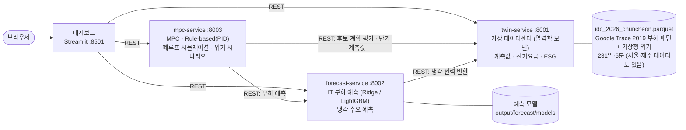

# AI Green IDC — 데이터센터 지능형 냉각·전력 최적화 시스템

가상 데이터센터(디지털 트윈) 위에서 IT 부하를 예측하고, MPC 로 공급 공기 설정 온도와 냉수 축열조를 제어해
**전기요금을 Rule-based 대비 10.2% 절감**하면서 서버실 온도를 18~27℃ 로 유지하는 시스템이다.
세 개의 FastAPI 서비스와 Streamlit 대시보드가 **REST API 로만** 통신한다.

| 핵심 결과 (Test 2026-05-30~06-12, 14일) | 값 | 과제 기준 |
|---|---|---|
| MPC 에너지 비용 절감 (Rule-based PID 대비) | **10.23%** (서버 급증 시나리오 11.38%) | 10% 이상 |
| MPC 최적화 계산 시간 | 2.6초 / 결정 | 5분 이내 |
| IT 부하 예측 MAPE 24h / 168h | **0.860% / 0.835%** (Ridge) | 5% / 8% 이내 |
| 90% 예측 구간 적중률 24h / 168h | 90.4% / 91.2% | 85% 이상 |
| 냉각 수요 예측 nMAE | **0.99%** | 10% 이내 |
| Rule-based 온도 유지율 · 위기 시나리오 최고 온도 | 100% · 27℃ 이하 | 95% 이상 · 27℃ 이하 |
| 열역학 모델 vs Sinergym (1년, 같은 IT 전력·외기) | 냉각 전력량 **-1.5%**, PUE **-0.2%** | 오차 10% 이내 |
| API 응답 시간 p95 | 2.70초 이하 (21개 엔드포인트) | 10초 이내 |
| 단위 테스트 · Coverage · PEP 8 | 208개 통과 · **91.3%** · 위반 0 | Coverage 60% 이상 |

---

## 1. 아키텍처



```
브라우저 ─▶ 대시보드 (:8501) ──REST──▶ MPC (:8003) ──REST──▶ 예측 (:8002) ──REST──▶ 트윈 (:8001)
                  │                          └──────────REST──────────────────────────▲
                  └───────────────────REST (계측·ESG·예측 직접 조회)──────────────────┘
```

| 모듈 | 폴더 | 포트 | 하는 일 |
|---|---|---|---|
| 디지털 트윈 | `services/twin/` | 8001 | 열역학 모델: 부하·외기·설정 온도 → 냉각 부하(Q = ṁc_pΔT)·냉각 전력·서버실 온도·PUE, 냉수 축열조, 전기요금, ESG |
| 예측 | `services/forecast/` | 8002 | 최근 IT 부하 → 1~168시간 IT 부하 + 90% 구간, 냉각 수요(냉각 전력·모드) 예측 |
| 제어 | `services/mpc/` | 8003 | MPC(scipy differential evolution), Rule-based(PID), 폐루프 시뮬레이션, 위기 시나리오 |
| 대시보드 | `dashboard/` | 8501 | PUE 게이지, 전력 추이, 서버 온도, 냉각 모드, 위기 시나리오 주입, 27℃ 초과 경고 |
| 스크립트 | `scripts/` | — | 모델 학습·비교·튜닝, 14일 제어기 비교 실험, API 응답 시간 측정 (저장소 루트에서 `python scripts/<이름>.py`). `data_prep/` 는 data 레포에서 가져온 ASHRAE 원본 정제 스크립트 |
| 설정 | `config/settings.yaml` | — | 서비스 주소, 데이터센터 상수, 요금표, MPC·PID 파라미터, 시나리오, API 키 환경변수 이름 |

MPC 의 한 번의 결정 (매시간): 예측 서비스에서 24시간 부하 예측 → 트윈에서 시간대별 단가 →
후보 계획(설정 온도 + 축열조 출력) 108개를 트윈 batch API 로 한 번에 평가하며 `scipy.optimize.differential_evolution`
으로 요금 최소화 → 첫 1시간 값만 적용, 다음 시간에 다시 계산.

---

## 2. 실행

### Docker (과제 기준: `docker-compose up`)

```bash
git lfs install && git lfs pull        # 데이터·결과 파일은 Git LFS
docker compose up --build
```

대시보드 http://localhost:8501 · API 문서 http://localhost:8001/docs, :8002/docs, :8003/docs.
확인 순서와 체크리스트: [`docs/docker.md`](docs/docker.md).

### Windows (Docker 없이)

`pip install -r requirements.txt` 후 **`start.bat`** (끌 때 `stop.bat`). 직접 띄우려면:

```bash
uvicorn services.twin.main:app --port 8001
uvicorn services.forecast.main:app --port 8002
uvicorn services.mpc.main:app --port 8003
streamlit run dashboard/app.py
```

Python 3.10~3.12. Windows 에서는 주소에 `localhost` 대신 `127.0.0.1` 을 쓴다 (`localhost` 는 연결마다 약 2초 지연).

### 빠른 호출 예

```bash
# 최적 냉각 제어: 현재 상태 → 24시간 최적 설정 온도·축열조 출력·예상 PUE
curl -X POST http://127.0.0.1:8003/api/v1/control/optimize -H "Content-Type: application/json" \
     -d '{"timestamp": "2026-06-04T06:00:00", "room_temp_c": 22, "current_setpoint_c": 22}'

# 예측: 앞으로 24시간 냉각 전력
curl -X POST http://127.0.0.1:8002/api/v1/forecast -H "Content-Type: application/json" \
     -d '{"horizon_hours": 24, "target": "cooling_power", "outdoor_forecast_c": [25,25,25,25,25,25,25,25,25,25,25,25,25,25,25,25,25,25,25,25,25,25,25,25]}'
```

전체 API: [`docs/API.md`](docs/API.md).

---

## 3. 문서

| 문서 | 내용 |
|---|---|
| [`docs/API.md`](docs/API.md) | API 명세서 (서비스 3개, 엔드포인트 19개: 요청·응답 필드, 오류, 예시). 기계용 `docs/openapi/*.json` |
| [`docs/thermodynamics.md`](docs/thermodynamics.md) | 열역학 모델 수식 (SPECpower, Q = ṁc_pΔT, COP, 외기 냉각, 서버실 열수지, 축열조, PUE·WUE·CUE, 요금) |
| [`docs/docker.md`](docs/docker.md) | Docker 실행·확인 가이드 |
| [`output/forecast/README_forecast.txt`](output/forecast/README_forecast.txt) | 예측 모델 학습·평가 상세 |
| `docs/references/` | 출처 자료 (한전 전기요금표 2026-06-01 시행) |

---

## 4. 과제 요구사항 대응

| # | 요구사항 | 구현 | 상태 |
|---|---|---|---|
| 1 | Docker · README 아키텍처 · docs/ 열역학 수식 | `docker-compose.yml`, 이 문서, `docs/thermodynamics.md` | ✅ (Docker 실행 확인은 `docs/docker.md` 기록표) |
| 2 | 데이터 파이프라인 | `scripts/build_dataset.py`: Google Cluster Data 1,600 VM 에서 CPU·메모리 사용률 패턴 추출, 기상청 ASOS API(기온·습도·풍속), 231일·5분 데이터(춘천·서울·제주), SPECpower, 파생 변수, 한전 현황 규모 | ✅  |
| 3 | 열역학 냉각 부하 모델 | `services/twin/physics.py` (Q = ṁc_pΔT, COP(외기), 외기 냉각, 칠러), NAVER PUE 1.09 비교, Sinergym 비교 오차 냉각 전력량 -1.5%·PUE -0.2% (`scripts/validate_sinergym.py`) | ✅ |
| 4 | IT 부하 예측 (모델 2개 이상) | Ridge·LightGBM·1주 전 값 비교 (`scripts/compare_forecast_models.py`), Val 기준 선정 | ✅ |
| 5 | 냉각 수요 예측 | `target=cooling_power`, nMAE 0.99%, 모드 적중률 99%, 외기 15℃ 이하 자연공조, 방식별 에너지 비교 | ✅ |
| 6 | Rule-based 컨트롤러 | 고정 설정 + PID (`services/mpc/rule_based.py`), 외기 기반 Free Cooling, 유지율 100% | ✅ |
| 7 | MPC (선택 A) | 예측 구간 24h, 요금 최소화, 온도·용량·변화율(±2℃/h) 제약, scipy, 10.23% 절감, 2.6초 | ✅ |
| 8 | 강화학습 (선택 B) | — | 선택하지 않음 |
| 9 | ESG 분석 | 시간대별 전력·탄소(0.459), WUE, 방식별 물 사용량, 요금 (`/api/v1/esg`), 제어기별 비용-에너지-탄소 Trade-off 그래프 (대시보드 ESG 탭) | ✅ |
| 10 | 위기 시나리오 | 서버 급증 +30%, 칠러 4대 중 1대 탈락, 폭염 38℃ — 모두 27℃ 이하, 대응 전략·비용. 복합 위기 3종(모두 27℃ 이하)과 한계 시험 1종(칠러 2대 탈락, 27℃ 요구 대상 아님) 추가 | ✅ |
| 11 | 대시보드 | Streamlit, PUE 게이지, 전력 추이, 서버 온도 추이·분포, 냉각 모드, 시나리오 주입, 27℃ 경고, 실제 시스템 상태·입력 이상 알람, 지역 비교 | ✅ |
| 12 | 시스템 아키텍처 | FastAPI 3개, REST 만 사용 (모듈 간 직접 함수 호출 없음) | ✅ |
| 13 | 코드 품질 | PEP 8 위반 0 (flake8), 함수 전부 타입 힌트, Coverage 91.3%, `docs/API.md` | ✅ |

---

## 5. 결과

### 제어기 비교 (Test 14일, `python scripts/simulate_mpc.py`)

| 제어 | 전기요금 | 요금 절감 (Rule-based 대비) | 전력량 절감 | PUE | 최고 온도 | 위반 |
|---|---|---|---|---|---|---|
| Rule-based (PID, 목표 20℃) | 1억 4,887만원 | — | — | 1.262 | 20.0℃ | 0 |
| Rule-based + 축열 시간표 | 1억 4,393만원 | 3.32% | 0.96% | 1.250 | 20.0℃ | 0 |
| 26℃ 고정 | 1억 3,895만원 | 6.66% | 6.16% | 1.169 | 26.0℃ | 0 |
| 반응형 (예측 없이 그 순간 최적) | 1억 3,754만원 | 7.61% | 7.13% | 1.161 | 27.0℃ | 0 |
| **MPC** | **1억 3,364만원** | **10.23%** | **8.35%** | **1.148** | 26.9℃ | 0 |

MPC 는 싼 경부하(밤)에 축열조를 충전하고 비싼 최대부하(15~21시)에 방전하며, 설정 온도를 서버 팬 전력이
늘기 직전까지 올린다. 설정 변화는 시간당 ±2℃ 이내로 제한한다.

### 위기 시나리오 (2026-06-03 하루 24시간, MPC)

| 시나리오 | 조건 | 최고 서버실 온도 | 평균 PUE | 하루 전기요금 | 비용 증가분 (정상 대비) | 대응 전략 |
|---|---|---|---|---|---|---|
| 정상 운영 | — | 26.8℃ | 1.182 | 726만원 | — | 예측 기반 설정 온도·축열조 최적화 |
| 서버 급증 | IT 부하 +30% | 26.8℃ | 1.194 | 955만원 | +31.5% | 학습 범위 밖 부하 → 예측 대신 최근 최대 부하 유지 가정으로 계획 |
| 칠러 고장 | 4대 중 1대 탈락 (용량 75%) | 26.7℃ | 1.197 | 735만원 | +1.2% | 남은 용량 안에서 운전, 축열조 방전으로 냉각 보충 |
| 폭염 | 외기 38℃ 이상 | 21.9℃ | 1.335 | 814만원 | +12.1% | 외기 냉각 불가 → 칠러 효율이 좋아지는 선까지만 설정 온도 상향 |

모든 시나리오에서 온도 유지율 100%, 위반 0. 서버 급증의 비용 증가는 대부분 IT 전력 자체가 30% 늘어난 몫이다.
칠러 고장은 남은 용량(3,750kW)이 이 날 부하보다 커서 영향이 작다.

### 복합 위기 시나리오 (2026-06-04 하루 24시간, MPC)

실제 사고는 위기가 겹쳐서 온다. 단일 위기 3종에 더해, 위기를 겹친 4종을 같은 설정 형식(`config/settings.yaml` 의 `scenarios`)으로 넣었다.

| 시나리오 | 조건 | 최고 서버실 온도 | 평균 PUE | 하루 전기요금 | 결과 |
|---|---|---|---|---|---|
| 정상 운영 | — | 26.8℃ | 1.140 | 1,085만원 | 위반 0 |
| 폭염 + 칠러 고장 | 외기 38℃ 이상, 1대 탈락 | 22.4℃ | 1.341 | 1,231만원 | 위반 0 |
| 서버 급증 + 폭염 | IT +30%, 외기 38℃ 이상 | 23.9℃ | 1.347 | 1,620만원 | 위반 0, 예측 불신 모드 23시간 |
| 세 위기 동시 | IT +30%, 외기 38℃ 이상, 1대 탈락 | 21.8℃ | 1.343 | 1,651만원 | 위반 0, 냉각 용량 한계 운전 14시간 |
| 칠러 2대 고장 | 4대 중 2대 탈락 (용량 50%) | 20시간 만에 위험 온도 32℃ 도달 | — | — | 위반 없이 17시간 운전 후 한계 |

- **세 위기 동시**는 예전에 서버 오류(HTTP 500)로 계산하지 못했다. 같은 조건에서 비교 기준인 20℃ 고정 운전의 온도가 발산해 합계가
  비었는데, 절감률을 그 값으로 나누고 있었다. 지금은 기준 운전을 계산할 수 없으면 절감률만 비우고 계획은 그대로 낸다.
- **칠러 2대 고장**은 냉각 용량(2,500kW)이 발열(약 2,900kW)보다 작아 어떤 설정 온도로도 막을 수 없다. 예전에는 서버 팬 전력 식에
  상한이 없어 서버실 온도가 수만 ℃ 로 발산했다. 팬 전력에 상한(위험 온도에서 최고 속도)을 두고, 위험 온도 32℃ 에 닿으면
  시뮬레이션을 멈춰 "몇 시간 만에 닿는지"를 결과로 낸다. 같은 날 20℃ 고정·Rule-based(PID)·축열 시간표는 5시간 만에 닿았고,
  MPC 는 축열조를 방전해 부족분을 메워 20시간을 버텼다. 이 시간이 부하 이전·복구에 쓸 수 있는 여유다.
- 시작일을 바꿔도(5/31, 6/04, 6/08) 복합 3종(폭염 + 칠러 고장, 급증 + 폭염, 세 위기 동시)은 모두 위반 0, 최고 21.8~24.4℃ 였다.
  칠러 2대 고장은 날짜에 따라 달라진다: 6/04 20시간, 6/08 19시간 만에 위험 온도에 닿았고, 5/31 에는 24시간 동안 닿지 않았다 (최고 30.5℃, 위반 2시간).
- 폭염 38℃ 와 40℃ 는 결과가 같다. 칠러 COP 가 유효 외기온도 약 24℃ 에서 이미 하한(3.26)에 닿기 때문이며, 고온에서의 효율 저하는 이 모델이 표현하지 못한다.

칠러 2대 고장은 **한계 시험**이다. 과제 요구(모든 시나리오 27℃ 이하)의 대상인 필수 3종·복합 3종과 구분해 설정(`limit_test: true`)과
대시보드에 따로 표시하고, 위기 시나리오 탭의 기본 선택에서 뺐다.

### 지역 비교: 춘천 · 서울 · 제주 (2026-03-23 ~ 10-31, 223일)

같은 가상 데이터센터(같은 IT 부하)를 세 지역의 외기(기상청 ASOS 실측)에 놓았다. 지역마다 다른 것은 외기뿐이다.

| 지역 | 외기 평균 | 외기 냉각 | 혼합 | 칠러 | 평균 PUE (20℃ 고정) | 전기요금 (20℃ 고정) |
|---|---|---|---|---|---|---|
| 춘천 | 19.9℃ | 1,355시간 | 705시간 | 3,292시간 | 1.248 | 21.72억원 |
| 서울 | 21.4℃ | 973시간 | 629시간 | 3,750시간 | 1.267 | 22.01억원 |
| 제주 | 22.7℃ | 578시간 | 593시간 | 4,181시간 | 1.282 | 22.21억원 |

MPC 요금 절감률 (Rule-based PID 대비, 계절별 1주일, 전체 전기요금 기준)

| 구간 | 춘천 | 서울 | 제주 |
|---|---|---|---|
| 4/13 (봄) | 7.4% | 8.7% | 5.9% |
| 6/08 (초여름) | 10.4% | 11.3% | 11.9% |
| 8/03 (한여름) | 6.2% | 3.9% | 4.7% |
| 10/05 (가을) | 5.8% | 7.5% | 11.1% |

- 12개 구간 모두 서버실 최고 온도 27.0℃ 이하, 위반 0시간. 예측 모델은 IT 부하만 쓰므로 세 지역에 같은 모델을 썼다.
- 절감률은 계절에 따라 4~12% 로 달라진다. IT 전력은 제어할 수 없고 전체 요금의 80% 이상이라, 절감률의 상한은 냉각 비중이다.
  외기가 외기 냉각 전환 구간(15~18℃)에 걸치는 시기(초여름, 제주의 가을)에 가장 크고, 한여름은 설정 온도를 올려도 외기 냉각으로 넘어가지 못해 작다.
- 제주는 겨울이 따뜻해 외기 냉각 시간이 춘천의 43% 다. 습도·염해·전력 계통(재생에너지 출력 제한) 같은 섬 조건은 모델에 없다.
- 다시 만드는 명령: `python scripts/build_dataset.py` (데이터), `python scripts/compare_sites.py` (비교, 약 10분). 대시보드 '지역 비교' 탭에서 본다.

### 입력 이상 감지와 실제 상태 표시

멘토 검증(2026-11-19)에서, 값이 학습 범위 **안**에 있는 입력 이상(센서 고착, +10% 계단, +12% 점진 드리프트, +15% 스파이크)은
알람 없이 통과했고 계단·드리프트에서는 예측이 8~10% 낮게 나왔다. 예측 서비스에 입력 이력 품질 검사 3종(고착, 1시간 급변, 1주 전 대비 평균 이동)을 넣었다.

| 넣은 이상 | 이전 | 지금 (이력 192시간, 예측 시점 1,969곳) |
|---|---|---|
| 정상 데이터 (오경보) | 0% | 0% |
| 최근 48시간 고착 / 168시간 고착 | 감지 0% | 100% |
| 최근 72시간 +10% 계단 | 감지 0% | 100% |
| 168시간 점진 드리프트 +12% | 감지 0% | 100% |
| 범위 안 스파이크 +15% (마지막 값) | 감지 0% | 99.3% |

- 걸리면 `warnings` 와 `input_quality_ok=false` 를 돌려주고, MPC 는 예측 대신 최근 최대 부하를 가정한다(mpc_naive).
- 한계: 평균 이동 검사는 1주 전 값과 비교하므로 이력이 192시간 이상일 때만 한다. 168시간만 받으면 "검사 못 함"으로 표시하고,
  이때 계단은 43%, 드리프트는 0% 만 잡힌다. 한계값은 합성 데이터 90일의 정상 변동으로 정한 값이라 실측 데이터에서는 다시 맞춰야 한다.
- MPC `/health` 는 예측·트윈에 닿지 않거나 직전 계획이 예측 불신·Fallback 이면 `degraded` 를 돌려준다 (이전에는 항상 `ok`).
- 대시보드 맨 위 배지는 **실제 시스템 상태**(서비스, MPC 경로, 예측 입력 품질)와 **시뮬레이션 조건**(위기 주입)을 따로 보여준다.
  IT 부하 예측 탭에서 이상을 직접 넣어 알람을 확인할 수 있다.

### 민감도 분석: 제어 지연·예측 오차 (Test 14일, `python scripts/sensitivity_analysis.py`)

MPC 가 계획할 때 보는 정보만 일부러 늦게·틀리게 주고(실제 설비에는 실측값), PUE·요금이 얼마나 나빠지는지 본다.

| 조건 | 평균 PUE | ΔPUE | 요금 변화 | Rule-based(PID) 대비 요금 절감 |
|---|---|---|---|---|
| 기준 MPC (지연·오차 없음) | 1.148 | — | — | **10.23%** |
| 제어 지연 1 / 2 / 3시간 | 1.155 / 1.164 / 1.172 | +0.007 / +0.016 / +0.023 | +0.6 / +1.5 / +2.5% | 9.67 / 8.89 / 7.98% |
| 외기 예보 오차 σ 1 / 2 / 3℃ | 1.151 / 1.155 / 1.161 | +0.003 / +0.007 / +0.013 | +0.2 / +0.8 / +1.2% | 10.02 / 9.53 / 9.14% |
| IT 부하 예측 무작위 오차 σ 5 / 10 / 20% | 1.148 / 1.148 / 1.148 | +0.001 이하 | +0.1% 이하 | 10.20~10.23% |
| IT 부하 예측 편향 −10 / +10% | 1.148 / 1.147 | ±0.001 | ±0.1% 이하 | 10.21 / 10.22% |

- **제어 지연이 가장 민감하다.** 1시간 늦을 때마다 절감률이 약 0.6~0.9%p 줄어든다. 요금 시간대(경부하·최대부하)가 바뀌는 시점에
  축열조 충·방전과 설정 온도 변경이 늦게 들어가기 때문으로 보인다. 그래도 3시간 지연에서도 PID 보다 8.0% 싸다.
- **외기 예보 오차**는 σ 1℃ 당 약 0.2~0.5%p 로, 제어 지연보다 영향이 작다.
- **IT 부하 예측 오차는 거의 영향이 없다.** 20% 무작위 오차·10% 편향에서도 0.03%p 이내. 서버 발열은 설정 온도와 무관하게
  어차피 빼내야 하는 열이라, 설정 온도 결정은 부하보다 외기·요금 시간대에 더 좌우되는 것으로 보인다.
- 모든 조건에서 온도 위반 0시간, 최고 서버실 온도 27.0℃ 이하. 그래프: `output/mpc/sensitivity.png`.
- 무작위 오차는 시드 1개로 뽑은 결과다. ±0.1%p 안의 차이(예: 편향 +10% 가 기준보다 약간 나은 것)는 최적화 탐색 결과의 흔들림 수준이다.

### 결과를 다시 만드는 명령

| 명령 | 결과 |
|---|---|
| `python scripts/build_dataset.py` (기상 자료는 `data/weather/` 에 저장돼 있어 API 키 없이 재현) | `data/idc_2026_{chuncheon,seoul,jeju}.parquet` |
| `python scripts/compare_sites.py` | `output/sites/site_comparison.json` (지역별 비교) |
| `python scripts/train_forecast.py` / `python scripts/train_ridge.py` | 예측 모델 (LightGBM / Ridge) |
| `python scripts/compare_forecast_models.py` | `output/forecast/model_comparison.json` |
| `python scripts/evaluate_cooling_forecast.py` | `output/forecast/cooling_metrics.json` (nMAE, 외기 오차 민감도) |
| `python scripts/simulate_mpc.py` · `--surge --start "2026-06-04 00:00" --days 3` | `output/mpc/` |
| `python scripts/sensitivity_analysis.py` (약 50분, 조건별 병렬) | `output/mpc/sensitivity.{json,csv,png}` |
| `python scripts/benchmark_api.py` (서비스 실행 중) | `output/benchmark/api_latency.json` |
| `docker compose --profile validation run --rm sinergym-validate` | `output/validation/` (Sinergym 1년 시계열, 비교 결과) |
| `python scripts/recompute_cooling_columns.py` (냉각 효율 계수를 바꿨을 때) | 데이터의 `cooling_power_kw`·`pue` 열 |

---

## 6. 테스트와 코드 품질

```bash
python -m pytest --cov        # 208개, Coverage 91.3% (기준 60%, setup.cfg)
python -m flake8              # PEP 8 (99자, black 호환) 위반 0
python -m black -l 99 -S .    # 자동 정리
```

- 테스트는 트윈 물리(데이터 재현, 에너지 보존, 해석해 비교), 예측(누수 방지, 학습=서빙), MPC(제약, 안전장치),
  API(정상·오류), 대시보드 화면 전체, 실행 스크립트를 다룬다. 대시보드·스크립트 테스트는 서비스 3개를 실제 HTTP 로 띄운다.
- Coverage 에서 data 레포에서 복사돼 온 일회성 데이터 정제 스크립트 6개(`scripts/data_prep/clean_data.py` 등)는 제외했다 (`setup.cfg`).

---

## 7. 가정과 한계

- **데이터**: IT 부하는 Google Cluster Data 1,600 VM 의 하루(24시간) 평균 패턴에 주말 배율과 잡음을 더해 231일로 늘린 가상 부하다.
  날마다 같은 패턴이 반복되고 계절 변화가 없어 예측 오차가 낙관적이다. 기간을 90일에서 231일로 늘리며 새로 들어온 정보는 외기(기상청 실측)뿐이다.
  원래 90일 데이터(`synthetic_idc_90d.parquet`)는 춘천 외기였고, 지금 기본 데이터(춘천)의 첫 90일과 같다.
- **트윈 가정값**: 서버실 열용량, 공기 유량, 팬 전력, 축열조 용량, 물 원단위 등은 데이터에 없는 가정값이다 (`config/settings.yaml` 의 [가정] 표시).
- **외기 예보**: 제어기 비교·위기 시나리오는 실측 외기를 예보로 썼다. 외기 오차 σ = 2℃ 면 냉각 수요 nMAE 가 12.3% 로 기준을 넘는다
  (`cooling_metrics.json`). MPC 에 미치는 영향은 5장 민감도 분석에 있다.
- **요금**: 2026-06-01 시행 요금표를 데이터 전체 기간(3~6월)에 적용했다. 기본요금·부가세는 제어와 무관해 제외했다.
- **Sinergym 검증과 계수 보정**: 원래 냉각 효율 계수(데이터에서 복원한 값)는 Sinergym 1년과 비교하면 냉각 전력량을
  23.0% 크게 잡았다. 그래서 계수 4개를 Sinergym 에 맞춰 다시 정했고 (냉각 전력량 -1.5%, PUE -0.2%), 데이터의 냉각 전력·PUE 열도
  새 계수로 다시 계산했다. 1년 합계는 맞지만 외기온도 구간별로는 ±15% 까지 어긋난다.
  실행: `docker compose --profile validation run --rm sinergym-validate`, 상세: `docs/thermodynamics.md` 11장.
- **설정 온도와 서버 팬 전력**: Sinergym 의 서버 모델은 설정 온도를 3℃ 올리면 서버 팬 전력 때문에 전체 전력이 7.1% 늘어난다.
  우리 모델은 24℃ 까지 팬 전력 증가가 없다고 가정해 1.9% 준다. MPC 의 절감 방향은 이 가정에 달려 있다 (`docs/thermodynamics.md` 11장).
- **기상청 API 수집**: 이 저장소에는 없다 (데이터 레포 담당).

---

## 8. 팀원별 기여

<!-- 팀원별 기여 내용을 작성해 주세요 -->

| 이름 | 역할 | 기여 내용 |
|---|---|---|
|  |  |  |
|  |  |  |
|  |  |  |
|  |  |  |
