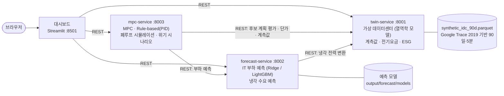

# AI Green IDC — 데이터센터 지능형 냉각·전력 최적화 시스템

가상 데이터센터(디지털 트윈) 위에서 IT 부하를 예측하고, MPC 로 공급 공기 설정 온도와 냉수 축열조를 제어해
**전기요금을 Rule-based 대비 11.5% 절감**하면서 서버실 온도를 18~27℃ 로 유지하는 시스템이다.
세 개의 FastAPI 서비스와 Streamlit 대시보드가 **REST API 로만** 통신한다.

| 핵심 결과 (Test 2026-05-30~06-12, 14일) | 값 | 과제 기준 |
|---|---|---|
| MPC 에너지 비용 절감 (Rule-based PID 대비) | **11.48%** (서버 급증 시나리오 12.89%) | 10% 이상 |
| MPC 최적화 계산 시간 | 0.4초 / 결정 | 5분 이내 |
| IT 부하 예측 MAPE 24h / 168h | **0.860% / 0.835%** (Ridge) | 5% / 8% 이내 |
| 90% 예측 구간 적중률 24h / 168h | 90.4% / 91.2% | 85% 이상 |
| 냉각 수요 예측 nMAE | **0.99%** | 10% 이내 |
| Rule-based 온도 유지율 · 위기 시나리오 최고 온도 | 100% · 27℃ 이하 | 95% 이상 · 27℃ 이하 |
| API 응답 시간 p95 | 0.44초 이하 (21개 엔드포인트) | 10초 이내 |
| 단위 테스트 · Coverage · PEP 8 | 193개 통과 · **93.7%** · 위반 0 | Coverage 60% 이상 |

---

## 1. 아키텍처



```
브라우저 ─▶ 대시보드 (:8501) ──REST──▶ MPC (:8003) ──REST──▶ 예측 (:8002) ──REST──▶ 트윈 (:8001)
                  │                          └──────────REST──────────────────────────▲
                  └───────────────────REST (계측·ESG·예측 직접 조회)──────────────────┘
```

| 모듈 | 폴더 | 포트 | 하는 일 |
|---|---|---|---|
| 디지털 트윈 | `services/twin/` | 8001 | 열역학 모델: 부하·외기·설정 온도 → 냉각 부하(Q = ṁc_pΔT)·냉각 전력·서버실 온도·PUE, 냉수 축열조, 전기요금, ESG |
| 예측 | `services/forecast/` | 8002 | 최근 IT 부하 → 1~168시간 IT 부하 + 90% 구간, 냉각 수요(냉각 전력·모드) 예측 |
| 제어 | `services/mpc/` | 8003 | MPC(scipy differential evolution), Rule-based(PID), 폐루프 시뮬레이션, 위기 시나리오 |
| 대시보드 | `dashboard/` | 8501 | PUE 게이지, 전력 추이, 서버 온도, 냉각 모드, 위기 시나리오 주입, 27℃ 초과 경고 |
| 스크립트 | `scripts/` | — | 모델 학습·비교·튜닝, 14일 제어기 비교 실험, API 응답 시간 측정 (저장소 루트에서 `python scripts/<이름>.py`). `data_prep/` 는 data 레포에서 가져온 ASHRAE 원본 정제 스크립트 |
| 설정 | `config/settings.yaml` | — | 서비스 주소, 데이터센터 상수, 요금표, MPC·PID 파라미터, 시나리오, API 키 환경변수 이름 |

MPC 의 한 번의 결정 (매시간): 예측 서비스에서 24시간 부하 예측 → 트윈에서 시간대별 단가 →
후보 계획(설정 온도 + 축열조 출력) 108개를 트윈 batch API 로 한 번에 평가하며 `scipy.optimize.differential_evolution`
으로 요금 최소화 → 첫 1시간 값만 적용, 다음 시간에 다시 계산.

---

## 2. 실행

### Docker (과제 기준: `docker-compose up`)

```bash
git lfs install && git lfs pull        # 데이터·결과 파일은 Git LFS
docker compose up --build
```

대시보드 http://localhost:8501 · API 문서 http://localhost:8001/docs, :8002/docs, :8003/docs.
확인 순서와 체크리스트: [`docs/docker.md`](docs/docker.md).

### Windows (Docker 없이)

`pip install -r requirements.txt` 후 **`start.bat`** (끌 때 `stop.bat`). 직접 띄우려면:

```bash
uvicorn services.twin.main:app --port 8001
uvicorn services.forecast.main:app --port 8002
uvicorn services.mpc.main:app --port 8003
streamlit run dashboard/app.py
```

Python 3.10~3.12. Windows 에서는 주소에 `localhost` 대신 `127.0.0.1` 을 쓴다 (`localhost` 는 연결마다 약 2초 지연).

### 빠른 호출 예

```bash
# 최적 냉각 제어: 현재 상태 → 24시간 최적 설정 온도·축열조 출력·예상 PUE
curl -X POST http://127.0.0.1:8003/api/v1/control/optimize -H "Content-Type: application/json" \
     -d '{"timestamp": "2026-06-04T06:00:00", "room_temp_c": 22, "current_setpoint_c": 22}'

# 예측: 앞으로 24시간 냉각 전력
curl -X POST http://127.0.0.1:8002/api/v1/forecast -H "Content-Type: application/json" \
     -d '{"horizon_hours": 24, "target": "cooling_power", "outdoor_forecast_c": [25,25,25,25,25,25,25,25,25,25,25,25,25,25,25,25,25,25,25,25,25,25,25,25]}'
```

전체 API: [`docs/API.md`](docs/API.md).

---

## 3. 문서

| 문서 | 내용 |
|---|---|
| [`docs/API.md`](docs/API.md) | API 명세서 (서비스 3개, 엔드포인트 19개: 요청·응답 필드, 오류, 예시). 기계용 `docs/openapi/*.json` |
| [`docs/thermodynamics.md`](docs/thermodynamics.md) | 열역학 모델 수식 (SPECpower, Q = ṁc_pΔT, COP, 외기 냉각, 서버실 열수지, 축열조, PUE·WUE·CUE, 요금) |
| [`docs/docker.md`](docs/docker.md) | Docker 실행·확인 가이드 |
| [`output/forecast/README_forecast.txt`](output/forecast/README_forecast.txt) | 예측 모델 학습·평가 상세 |
| `docs/references/` | 출처 자료 (한전 전기요금표 2026-06-01 시행) |

---

## 4. 과제 요구사항 대응

| # | 요구사항 | 구현 | 상태 |
|---|---|---|---|
| 1 | Docker · README 아키텍처 · docs/ 열역학 수식 | `docker-compose.yml`, 이 문서, `docs/thermodynamics.md` | ✅ (Docker 실행 확인은 `docs/docker.md` 기록표) |
| 2 | 데이터 파이프라인 | Google Trace 2019 기반 90일·5분 데이터, SPECpower, 파생 변수, 한전 현황 규모 | ✅  |
| 3 | 열역학 냉각 부하 모델 | `services/twin/physics.py` (Q = ṁc_pΔT, COP(외기), 외기 냉각, 칠러), NAVER PUE 1.09 비교 | ✅ |
| 4 | IT 부하 예측 (모델 2개 이상) | Ridge·LightGBM·1주 전 값 비교 (`scripts/compare_forecast_models.py`), Val 기준 선정 | ✅ |
| 5 | 냉각 수요 예측 | `target=cooling_power`, nMAE 0.99%, 모드 적중률 99%, 외기 15℃ 이하 자연공조, 방식별 에너지 비교 | ✅ |
| 6 | Rule-based 컨트롤러 | 고정 설정 + PID (`services/mpc/rule_based.py`), 외기 기반 Free Cooling, 유지율 100% | ✅ |
| 7 | MPC (선택 A) | 예측 구간 24h, 요금 최소화, 온도·용량·변화율(±2℃/h) 제약, scipy, 11.48% 절감, 0.4초 | ✅ |
| 8 | 강화학습 (선택 B) | — | 선택하지 않음 |
| 9 | ESG 분석 | 시간대별 전력·탄소(0.459), WUE, 방식별 물 사용량, 요금 (`/api/v1/esg`) | ✅ |
| 10 | 위기 시나리오 | 서버 급증 +30%, 칠러 4대 중 1대 탈락, 폭염 38℃ — 모두 27℃ 이하, 대응 전략·비용 | ✅ |
| 11 | 대시보드 | Streamlit, PUE 게이지, 전력 추이, 서버 온도, 냉각 모드, 시나리오 주입, 27℃ 경고 | ✅ |
| 12 | 시스템 아키텍처 | FastAPI 3개, REST 만 사용 (모듈 간 직접 함수 호출 없음) | ✅ |
| 13 | 코드 품질 | PEP 8 위반 0 (flake8), 함수 전부 타입 힌트, Coverage 93.4%, `docs/API.md` | ✅ |

---

## 5. 결과

### 제어기 비교 (Test 14일, `python scripts/simulate_mpc.py`)

| 제어 | 전기요금 | 요금 절감 (Rule-based 대비) | 전력량 절감 | PUE | 최고 온도 | 위반 |
|---|---|---|---|---|---|---|
| Rule-based (PID, 목표 20℃) | 1억 5,496만원 | — | — | 1.311 | 20.0℃ | 0 |
| Rule-based + 축열 시간표 | 1억 4,895만원 | 3.87% | 1.12% | 1.296 | 20.0℃ | 0 |
| 26℃ 고정 | 1억 4,273만원 | 7.89% | 7.32% | 1.199 | 26.0℃ | 0 |
| 반응형 (예측 없이 그 순간 최적) | 1억 4,101만원 | 9.00% | 8.41% | 1.187 | 27.0℃ | 0 |
| **MPC** | **1억 3,717만원** | **11.48%** | **9.34%** | **1.181** | 26.9℃ | 0 |

MPC 는 싼 경부하(밤)에 축열조를 충전하고 비싼 최대부하(15~21시)에 방전하며, 설정 온도를 서버 팬 전력이
늘기 직전까지 올린다. 설정 변화는 시간당 ±2℃ 이내로 제한한다.

### 위기 시나리오 (2026-06-03 하루 24시간, MPC)

| 시나리오 | 조건 | 최고 서버실 온도 | 평균 PUE | 하루 전기요금 | 비용 증가분 (정상 대비) | 대응 전략 |
|---|---|---|---|---|---|---|
| 정상 운영 | — | 26.7℃ | 1.232 | 755만원 | — | 예측 기반 설정 온도·축열조 최적화 |
| 서버 급증 | IT 부하 +30% | 26.5℃ | 1.242 | 988만원 | +31.0% | 학습 범위 밖 부하 → 예측 대신 최근 최대 부하 유지 가정으로 계획 |
| 칠러 고장 | 4대 중 1대 탈락 (용량 75%) | 26.6℃ | 1.239 | 760만원 | +0.6% | 남은 용량 안에서 운전, 축열조 방전으로 냉각 보충 |
| 폭염 | 외기 38℃ 이상 | 24.0℃ | 1.435 | 875만원 | +15.9% | 외기 냉각 불가 → 칠러 효율이 좋아지는 선까지만 설정 온도 상향 |

모든 시나리오에서 온도 유지율 100%, 위반 0. 서버 급증의 비용 증가는 대부분 IT 전력 자체가 30% 늘어난 몫이다.
칠러 고장은 남은 용량(3,750kW)이 이 날 부하보다 커서 영향이 작다.

### 민감도 분석: 제어 지연·예측 오차 (Test 14일, `python scripts/sensitivity_analysis.py`)

MPC 가 계획할 때 보는 정보만 일부러 늦게·틀리게 주고(실제 설비에는 실측값), PUE·요금이 얼마나 나빠지는지 본다.

| 조건 | 평균 PUE | ΔPUE | 요금 변화 | Rule-based(PID) 대비 요금 절감 |
|---|---|---|---|---|
| 기준 MPC (지연·오차 없음) | 1.181 | — | — | **11.48%** |
| 제어 지연 1 / 2 / 3시간 | 1.190 / 1.201 / 1.206 | +0.009 / +0.020 / +0.025 | +0.8 / +1.9 / +2.7% | 10.75 / 9.80 / 9.13% |
| 외기 예보 오차 σ 1 / 2 / 3℃ | 1.184 / 1.186 / 1.190 | +0.003 / +0.005 / +0.009 | +0.3 / +0.6 / +0.9% | 11.18 / 10.99 / 10.67% |
| IT 부하 예측 무작위 오차 σ 5 / 10 / 20% | 1.182 / 1.181 / 1.182 | +0.002 이하 | +0.1% 이하 | 11.35~11.44% |
| IT 부하 예측 편향 −10 / +10% | 1.182 / 1.180 | ±0.001 | ±0.1% 이하 | 11.41 / 11.51% |

- **제어 지연이 가장 민감하다.** 1시간 늦을 때마다 절감률이 약 0.8%p 줄어든다. 요금 시간대(경부하·최대부하)가 바뀌는 시점에
  축열조 충·방전과 설정 온도 변경이 늦게 들어가기 때문으로 보인다. 그래도 3시간 지연에서도 PID 보다 9.1% 싸다.
- **외기 예보 오차**는 σ 1℃ 당 약 0.3%p. 기상청 단기예보 수준(σ 1~2℃)이면 절감률 11% 안팎이 유지된다.
- **IT 부하 예측 오차는 거의 영향이 없다.** 20% 무작위 오차·10% 편향에서도 0.1%p 이내. 서버 발열은 설정 온도와 무관하게
  어차피 빼내야 하는 열이라, 설정 온도 결정은 부하보다 외기·요금 시간대에 더 좌우되는 것으로 보인다.
- 모든 조건에서 온도 위반 0시간, 최고 서버실 온도 26.9℃ 이하. 그래프: `output/mpc/sensitivity.png`.
- 무작위 오차는 시드 1개로 뽑은 결과다. ±0.1%p 안의 차이(예: 편향 +10% 가 기준보다 약간 나은 것)는 최적화 탐색 결과의 흔들림 수준이다.

### 결과를 다시 만드는 명령

| 명령 | 결과 |
|---|---|
| `python scripts/train_forecast.py` / `python scripts/train_ridge.py` | 예측 모델 (LightGBM / Ridge) |
| `python scripts/compare_forecast_models.py` | `output/forecast/model_comparison.json` |
| `python scripts/evaluate_cooling_forecast.py` | `output/forecast/cooling_metrics.json` (nMAE, 외기 오차 민감도) |
| `python scripts/simulate_mpc.py` · `--surge --start "2026-06-04 00:00" --days 3` | `output/mpc/` |
| `python scripts/sensitivity_analysis.py` (약 3~10분, 조건별 병렬) | `output/mpc/sensitivity.{json,csv,png}` |
| `python scripts/benchmark_api.py` (서비스 실행 중) | `output/benchmark/api_latency.json` |

---

## 6. 테스트와 코드 품질

```bash
python -m pytest --cov        # 196개, Coverage 93.4% (기준 60%, setup.cfg)
python -m flake8              # PEP 8 (99자, black 호환) 위반 0
python -m black -l 99 -S .    # 자동 정리
```

- 테스트는 트윈 물리(데이터 재현, 에너지 보존, 해석해 비교), 예측(누수 방지, 학습=서빙), MPC(제약, 안전장치),
  API(정상·오류), 대시보드 화면 전체, 실행 스크립트를 다룬다. 대시보드·스크립트 테스트는 서비스 3개를 실제 HTTP 로 띄운다.
- Coverage 에서 data 레포에서 복사돼 온 일회성 데이터 정제 스크립트 6개(`scripts/data_prep/clean_data.py` 등)는 제외했다 (`setup.cfg`).

---

## 7. 가정과 한계

- **데이터**: Google Cluster Trace 2019(약 31일)를 90일로 확장한 반합성 데이터. 주간 패턴이 규칙적이라 예측 오차가 낙관적이다.
- **트윈 가정값**: 서버실 열용량, 공기 유량, 팬 전력, 축열조 용량, 물 원단위 등은 데이터에 없는 가정값이다 (`config/settings.yaml` 의 [가정] 표시).
- **외기 예보**: 제어기 비교·위기 시나리오는 실측 외기를 예보로 썼다. 외기 오차 σ = 2℃ 면 냉각 수요 nMAE 가 11.9% 로 기준을 넘지만
  (`cooling_metrics.json`), MPC 요금 절감률은 11.48% → 10.99% 로 조금만 줄어든다 (5장 민감도 분석).
- **요금**: 2026-06-01 시행 요금표를 데이터 전체 기간(3~6월)에 적용했다. 기본요금·부가세는 제어와 무관해 제외했다.
- **Sinergym 검증·기상청 API 수집**: 이 저장소에는 없다 (데이터 레포 담당).

---

## 8. 팀원별 기여

<!-- 팀원별 기여 내용을 작성해 주세요 -->

| 이름 | 역할 | 기여 내용 |
|---|---|---|
|  |  |  |
|  |  |  |
|  |  |  |
|  |  |  |
